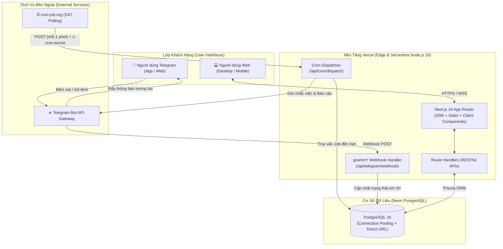
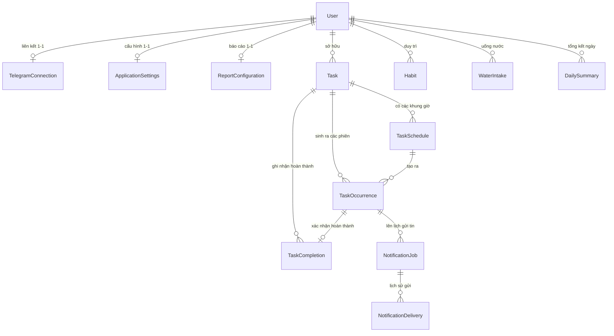

# 🏛️ 01. TỔNG QUAN KIẾN TRÚC HỆ THỐNG

Tài liệu này phân tích chi tiết thiết kế kiến trúc tổng thể, sơ đồ luồng dữ liệu, cấu trúc cơ sở dữ liệu và các quyết định kỹ thuật nền tảng của hệ thống **DailyFlow**.

---

## 1. SƠ ĐỒ KIẾN TRÚC TỔNG THỂ (SYSTEM ARCHITECTURE)

Hệ thống được thiết kế theo mô hình **Serverless Event-Driven**:



---

## 2. TECH STACK & LÝ DO LỰA CHỌN

| Thành phần | Công nghệ | Lý do kỹ thuật |
| :--- | :--- | :--- |
| **Framework** | Next.js 16 (App Router + Turbopack) | Tốc độ biên dịch siêu tốc, hỗ trợ Server Components tối ưu SEO và Route Handlers chuẩn Web Standards (Request/Response). |
| **Ngôn ngữ** | TypeScript 5 (Strict Mode) | Đảm bảo an toàn kiểu dữ liệu 100%, tự động bắt lỗi từ lúc viết code, tự sinh kiểu từ Prisma Client. |
| **Database** | Neon PostgreSQL (Serverless) | Tự động co giãn (auto-scaling), hỗ trợ Connection Pooling giải quyết triệt để giới hạn kết nối của Serverless Functions. |
| **ORM** | Prisma ORM v6 | Type-safe migrations, cú pháp truy vấn trực quan, hỗ trợ transactions atomic (`prisma.$transaction`). |
| **Bot Engine** | grammY | Thư viện Telegram Bot hiện đại nhất hệ sinh thái Node.js/TypeScript, hỗ trợ Webhook Adapter native không cần Express. |
| **Styling** | Tailwind CSS v4 + Lucide Icons | Xây dựng giao diện Responsive chuẩn di động cực nhanh, hỗ trợ Dark/Light theme trực tiếp qua CSS variables. |
| **Kéo-thả** | `@dnd-kit/core` | Hỗ trợ thao tác kéo-thả cảm ứng (Touch + Pointer Sensor) trên cả điện thoại và máy tính mượt mà. |
| **Lên lịch Cron** | cron-job.org | Giải pháp kích hoạt cron 24/7 hoàn toàn miễn phí, độc lập với máy chủ, độ trễ dưới 2 giây. |

---

## 3. THIẾT KẾ CƠ SỞ DỮ LIỆU (DATABASE SCHEMA)

Cơ sở dữ liệu bao gồm 12 mô hình (Models) có liên kết chặt chẽ, tối ưu cho việc truy vấn lịch trình theo thời gian thực:



### Chi tiết các thực thể cốt lõi:

1. **`User`**: Chủ sở hữu hệ thống. Lưu trữ thông tin định danh, email, tên hiển thị và múi giờ (`Asia/Ho_Chi_Minh`).
2. **`TelegramConnection`**: Quản lý kết nối với tài khoản Telegram:
   - `chatId`: ID cuộc trò chuyện Telegram duy nhất.
   - `pairingCode`: Mã OTP ngẫu nhiên 6 chữ số có hạn 15 phút.
   - `isActive`, `isPaused`: Kiểm soát trạng thái bật/tắt nhận tin.
3. **`Task`**: Định nghĩa hoạt động (Title, Category, Priority, Mục tiêu Target Value & Unit). Hỗ trợ soft-delete qua trường `deletedAt`.
4. **`TaskSchedule`**: Quy tắc lặp của hoạt động:
   - `startTime`: Chuỗi giờ định dạng `HH:mm` (ví dụ `08:30`).
   - `recurrenceType`: `DAILY`, `WEEKDAYS`, `WEEKENDS`, `CUSTOM`, `ONCE`.
   - `recurrenceDays`: Mảng số JSON đại diện cho các thứ trong tuần (`[0,1,2,3,4,5,6]`).
5. **`TaskOccurrence`**: Phiên thực thi cụ thể của một Task vào một ngày nhất định.
   - Trạng thái: `PENDING`, `COMPLETED`, `SKIPPED`, `SNOOZED`, `MISSED`.
   - `scheduledAt`: Thời điểm DateTime UTC tính toán theo múi giờ Việt Nam.
6. **`NotificationJob`**: Hàng đợi công việc gửi tin nhắn Telegram.
   - `status`: `PENDING`, `SENT`, `FAILED`, `CANCELLED`.
   - `scheduledFor`: Thời điểm cụ thể cần kích hoạt gửi tin.
   - `retryCount`: Số lần thử lại tối đa 3 lần nếu Telegram API gián đoạn.
7. **`WaterIntake`**: Bản ghi nạp nước hàng ngày (ml), đồng bộ nguồn từ `WEB` hoặc `TELEGRAM`.
8. **`ReportConfiguration`**: Cấu hình thời gian gửi báo cáo Ngày (`22:00`), Tuần (`CN 21:45`), Tháng (`22:15`).

---

## 4. CƠ CHẾ XỬ LÝ MÚI GIỜ (TIMEZONE ENGINE: ASIA/HO_CHI_MINH)

> [!CAUTION]
> **Cạm bẫy Serverless Vercel**: Máy chủ Vercel chạy mặc định ở múi giờ UTC (GMT+0). Nếu sử dụng `new Date().setHours(0, 0, 0, 0)`, ngày bắt đầu sẽ bị lệch 7 tiếng so với Việt Nam (dẫn đến việc ngày mới bắt đầu lúc 07:00 sáng tại Việt Nam)!

### Giải pháp kỹ thuật trong `src/lib/schedule/engine.ts`:
Hệ thống sử dụng các hàm toán học chuyên dụng độc lập với múi giờ của máy chủ:

```typescript
// 1. Lấy chuỗi ngày "YYYY-MM-DD" chính xác theo giờ Việt Nam
export function getVietnamDateString(date: Date = new Date()): string {
  const formatter = new Intl.DateTimeFormat("en-CA", {
    timeZone: "Asia/Ho_Chi_Minh",
    year: "numeric",
    month: "2-digit",
    day: "2-digit",
  });
  return formatter.format(date); // Luôn trả về "2026-10-24" đúng giờ VN
}

// 2. Kết hợp Ngày VN và Giờ "HH:mm" thành mốc thời gian UTC tuyệt đối
export function combineVietnamDateAndTime(dateStr: string, timeStr: string): Date {
  // Offset cố định của Việt Nam là UTC+7 (+07:00)
  const isoString = `${dateStr}T${timeStr}:00+07:00`;
  return new Date(isoString);
}
```

Nhờ cơ chế này, toàn bộ thời điểm thông báo trong Database luôn tương ứng chính xác 100% với giờ đồng hồ treo tường của người dùng tại Việt Nam.

---

## 5. BẢO MẬT & XÁC THỰC (AUTHENTICATION & SECURITY)

1. **Quản trị Web (PIN Admin + JWT)**:
   - Truy cập lần đầu yêu cầu mã PIN cá nhân (`ADMIN_PIN`).
   - Khi xác thực thành công, hệ thống cấp JWT Session Token có chữ ký bảo mật HS256 (`jose`), lưu trong Cookie `httpOnly`, `SameSite=Lax`, `Secure`, thời hạn 30 ngày.
2. **Khóa bảo mật Webhook Telegram (`TELEGRAM_WEBHOOK_SECRET`)**:
   - Khi Telegram gửi sự kiện đến `/api/telegram/webhook`, header `x-telegram-bot-api-secret-token` được kiểm tra bằng thuật toán so sánh chuỗi thời gian không đổi (constant-time comparison) chống tấn công Timing Attack.
3. **Khóa bảo vệ Cron (`CRON_SECRET`)**:
   - Mọi yêu cầu gọi đến `/api/cron/dispatch` và `/api/cron/prepare-day` bắt buộc phải kèm header `x-cron-secret`. Bất kỳ yêu cầu nào không có secret đều bị từ chối với mã lỗi `401 Unauthorized`.
