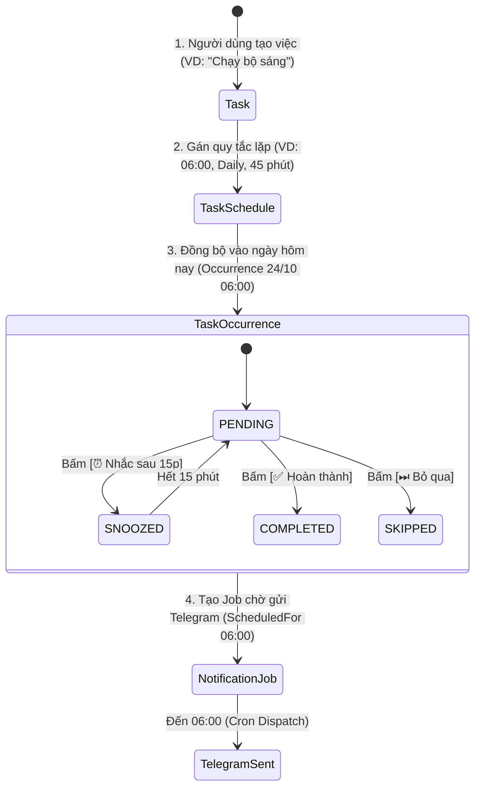
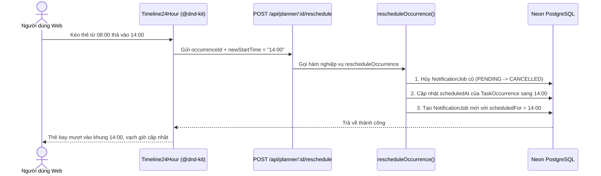

# ⏱️ 02. BỘ MÁY LẬP LỊCH 24 GIỜ (SCHEDULE ENGINE)

Tài liệu này giải thích chi tiết động cơ lập lịch thời gian thực, thuật toán phân chia khung giờ, phát hiện xung đột và cơ chế kéo-thả dời lịch thông minh được triển khai tại [[src/lib/schedule/engine.ts](file:///home/zinex/code/Bot-notice/src/lib/schedule/engine.ts)] và [[src/lib/schedule/service.ts](file:///home/zinex/code/Bot-notice/src/lib/schedule/service.ts)].

---

## 1. VÒNG ĐỜI DỮ LIỆU CỦA MỘT LỊCH TRÌNH

Trong hệ thống DailyFlow, một công việc trải qua 4 cấp độ dữ liệu:



* **`Task`**: Thực thể chứa thông tin tĩnh (tên việc, danh mục `WATER`, `EXERCISE`, `STUDY`, `WORK`, `HEALTH`, `OTHER`, mục tiêu số lượng).
* **`TaskSchedule`**: Quy tắc tần suất lặp (giờ bắt đầu `startTime`, thời lượng `durationMinutes`, loại lặp `DAILY`, `WEEKDAYS`, `WEEKENDS`, `CUSTOM`).
* **`TaskOccurrence`**: Phiên làm việc thực tế diễn ra trong ngày `YYYY-MM-DD`. Mỗi phiên có trạng thái riêng biệt, ghi nhận nhật ký hoàn thành độc lập.
* **`NotificationJob`**: Lệnh đẩy tin nhắn Telegram đến hạn.

---

## 2. THUẬT TOÁN ĐỒNG BỘ LỊCH HÔM NAY (`syncDailyOccurrences`)

Hàm `syncDailyOccurrences(userId, dateStr)` đảm bảo mọi hoạt động có quy tắc phù hợp với ngày được chọn đều có sẵn phiên `TaskOccurrence` và `NotificationJob`:

1. **Xác định thứ trong tuần**:
   - `0`: Chủ Nhật, `1`: Thứ Hai, ..., `6`: Thứ Bảy theo giờ Việt Nam.
2. **Kiểm tra quy tắc lặp**:
   - `DAILY`: Luôn tạo phiên mỗi ngày.
   - `WEEKDAYS`: Chỉ tạo từ Thứ Hai đến Thứ Sáu (`1 <= dayOfWeek <= 5`).
   - `WEEKENDS`: Chỉ tạo Thứ Bảy và Chủ Nhật (`dayOfWeek === 0 || dayOfWeek === 6`).
   - `CUSTOM`: Kiểm tra mảng số lưu trong trường `recurrenceDays` (ví dụ `[1, 3, 5]` cho Thứ 2-4-6).
   - `ONCE`: Chỉ tạo vào ngày bắt đầu (`effectiveFrom`).
3. **Tính Idempotent (Bất biến)**:
   - Nếu đã tồn tại `TaskOccurrence` cho `scheduleId` và ngày này, hệ thống sẽ bỏ qua, không bao giờ tạo trùng lặp dữ liệu.
4. **Tạo NotificationJob tự động**:
   - Ngay khi `TaskOccurrence` được tạo mới, hệ thống tự động sinh một `NotificationJob` với `scheduledFor = scheduledAt` nếu `telegramEnabled = true`.

---

## 3. THUẬT TOÁN PHÁT HIỆN XUNG ĐỘT THỜI GIAN (`detectConflicts`)

Khi có nhiều hoạt động diễn ra trong ngày, việc hai hoạt động bị trùng khung giờ có thể làm giảm hiệu quả làm việc. DailyFlow tích hợp thuật toán phát hiện xung đột:

### Nguyên lý toán học:
Mỗi mốc thời gian `HH:mm` được chuyển đổi thành số phút tính từ 00:00:
$$\text{Minutes} = \text{Hour} \times 60 + \text{Minute}$$

Ví dụ: `09:30` ➔ $9 \times 60 + 30 = 570$ phút.

Một công việc $A$ có khoảng thời gian $[Start_A, End_A]$ và công việc $B$ có $[Start_B, End_B]$ xung đột khi và chỉ khi:
$$Start_A < End_B \quad \text{VÀ} \quad Start_B < End_A$$
*(với điều kiện thời lượng của cả hai đều lớn hơn 0 phút)*.

```typescript
export function detectConflicts(items: Array<{ id: string; startTime: string; durationMinutes: number; title: string }>) {
  const conflicts: TimeConflict[] = [];
  const conflictingIds = new Set<string>();

  for (let i = 0; i < items.length; i++) {
    for (let j = i + 1; j < items.length; j++) {
      const a = items[i];
      const b = items[j];

      if (a.durationMinutes === 0 || b.durationMinutes === 0) continue;

      const aStart = timeStringToMinutes(a.startTime);
      const aEnd = aStart + a.durationMinutes;
      const bStart = timeStringToMinutes(b.startTime);
      const bEnd = bStart + b.durationMinutes;

      // Kiểm tra giao thoa khoảng thời gian
      if (aStart < bEnd && bStart < aEnd) {
        conflicts.push({
          taskAId: a.id,
          taskBId: b.id,
          taskATitle: a.title,
          taskBTitle: b.title,
          overlapMinutes: Math.min(aEnd, bEnd) - Math.max(aStart, bStart),
        });
        conflictingIds.add(a.id);
        conflictingIds.add(b.id);
      }
    }
  }

  return { conflicts, conflictingIds };
}
```

Trên giao diện Web, các công việc bị trùng giờ sẽ hiển thị viền cảnh báo màu hổ phách (amber) kèm biểu tượng ⚠️ và ghi chú thời gian bị chồng lấn.

---

## 4. CƠ CHẾ KÉO-THẢ DỜI GIỜ THÔNG MINH (DRAG & DROP)

Trên giao diện [[Timeline24Hour.tsx](file:///home/zinex/code/Bot-notice/src/components/planner/Timeline24Hour.tsx)], người dùng có thể giữ tay cầm `GripVertical` để kéo bất kỳ thẻ hoạt động nào thả vào khung giờ mới:



> [!TIP]
> **Giữ nguyên số phút lẻ khi dời lịch**: Nếu công việc đang đặt ở `08:15` và bạn kéo thả vào ô `14:00`, hệ thống sẽ tự động tính toán lại thành `14:15`, giúp người dùng không bị mất số phút lẻ đã thiết lập trước đó.

---

## 5. CÁC THAO TÁC CẬP NHẬT TRẠNG THÁI

| Thao tác | Mô tả nghiệp vụ | Tác động cơ sở dữ liệu |
| :--- | :--- | :--- |
| **`completeTaskOccurrence`** | Đánh dấu hoàn thành từ Web hoặc nút `[✅ Hoàn thành]` trên bot. | Cập nhật `TaskOccurrence.status = COMPLETED`, ghi bản ghi `TaskCompletion`. Nếu thuộc danh mục `WATER`, tự động ghi thêm bản ghi vào bảng `WaterIntake`. Hủy các thông báo đang chờ. |
| **`snoozeOccurrence`** | Hoãn nhắc nhở (mặc định 15 phút) từ bot. | Cập nhật `TaskOccurrence.status = SNOOZED`, `snoozedUntil = now + 15 phút`. Cập nhật `NotificationJob.scheduledFor = now + 15 phút`. |
| **`deleteScheduleItem`** | Xóa lịch nhắc (hỗ trợ 2 phạm vi: `THIS_OCCURRENCE` hoặc `ALL`). | `THIS_OCCURRENCE`: Chỉ đánh dấu `SKIPPED` phiên hiện tại, hủy job hôm nay. `ALL`: Soft-delete Task (`deletedAt = now`), hủy toàn bộ job tương lai, giữ nguyên lịch sử báo cáo cũ. |
| **`toggleTaskActive`** | Bật/Tắt công việc tạm thời. | Cập nhật `Task.isActive`. Nếu tắt: tự động hủy toàn bộ các `NotificationJob` tương lai đang ở trạng thái `PENDING`. |
