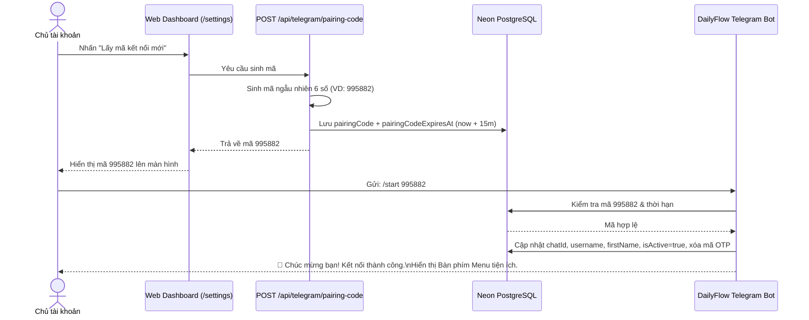

# 🤖 03. TELEGRAM BOT & TƯƠNG TÁC HAI CHIỀU

Tài liệu này phân tích chi tiết cơ chế hoạt động của Telegram Bot thông minh, quy trình bảo mật ghép nối tài khoản, các loại bàn phím tương tác và giải pháp kỹ thuật triệt tiêu hiện tượng treo bot (hanging).

---

## 1. QUY TRÌNH GHÉP NỐI TÀI KHOẢN QUA MÃ OTP (PAIRING FLOW)

Để bảo vệ sự riêng tư và ngăn chặn việc mạo danh tài khoản, DailyFlow không cho phép người dùng nhập trực tiếp Chat ID. Thay vào đó, hệ thống sử dụng quy trình **OTP 6 chữ số một lần có thời hạn 15 phút**:



---

## 2. BÀN PHÍM MENU DƯỚI KHUNG CHAT (REPLY KEYBOARD)

Ngay sau khi kết nối hoặc khi người dùng gõ `/start`, `/help`, bot sẽ tự động neo **Bàn phím tương tác thường trực (Persistent ReplyKeyboardMarkup)** ngay dưới màn hình chat của điện thoại:

```text
┌─────────────────────────┬─────────────────────────┐
│     📅 Lịch hôm nay     │       💧 Uống nước      │
├─────────────────────────┼─────────────────────────┤
│     📊 Báo cáo ngay     │     ⏳ Việc chưa xong   │
├─────────────────────────┼─────────────────────────┤
│  🌐 Mở Web DailyFlow   │       ❓ Trợ giúp       │
└─────────────────────────┴─────────────────────────┘
```

> [!TIP]
> **Mở Web App trực tiếp trong Telegram (Telegram Mini App)**:
> Nút `🌐 Mở Web DailyFlow` được cấu hình dưới dạng **`web_app` button**. Khi bấm, Telegram sẽ mở trực tiếp ứng dụng web DailyFlow dưới dạng cửa sổ trượt (in-app modal) với đầy đủ thanh điều hướng dưới đáy (Mobile Bottom Bar), lịch 24 giờ và bảng thống kê mà người dùng không cần phải thoát ra trình duyệt ngoài!

### Xử lý tin nhắn văn bản tự nhiên (`bot.hears`):
Người dùng không cần nhớ cú pháp dấu gạch chéo (`/`). Khi người dùng chạm vào nút hoặc gõ từ ngữ tương tự, hệ thống tự động nhận diện và phản hồi:
- `📅 Lịch hôm nay`, `lịch`, `hôm nay`, `today` ➔ Gọi hàm `handleTodayCommand`
- `💧 Uống nước`, `nước`, `water` ➔ Gọi hàm `handleWaterCommand`
- `📊 Báo cáo ngay`, `báo cáo`, `report` ➔ Gọi hàm `handleReportCommand`
- `⏳ Việc chưa xong`, `chưa xong`, `pending` ➔ Gọi hàm `handlePendingCommand`
- `🌐 Web Dashboard`, `web`, `dashboard` ➔ Gửi link mở Web App
- `❓ Trợ giúp`, `hướng dẫn`, `help` ➔ Gửi hướng dẫn lệnh

---

## 3. NÚT TƯƠNG TÁC DƯỚI TIN NHẮN (INLINE KEYBOARD & MINI APP)

Dưới mỗi tin nhắn thông báo nhắc việc hoặc tiến độ nước uống, bot tự động đính kèm các nút bấm tương tác nhanh:

### Mẫu tin nhắn nhắc việc:
```text
🏋️ NHẮC LỊCH: TẬP THỂ DỤC BUỔI CHIỀU
⏰ Thời gian: 17:30 (45 phút)
🎯 Mục tiêu: 45 phút chạy bộ
📝 Ghi chú: Chạy tại công viên hoặc máy chạy bộ

[ ✅ Hoàn thành ]   [ ⏰ Nhắc sau 15p ]
[ ⏭ Bỏ qua ]
```

### Mẫu tin nhắn uống nước:
```text
💧 NHẮC UỐNG NƯỚC
Đến giờ uống nước rồi!
📊 Đã uống hôm nay: 1,000 / 1,500 ml

[ 🥛 +250 ml ]   [ 🍶 +500 ml ]
[ 📊 Xem chi tiết trên Web ]
```

---

## 4. GIẢI PHÁP TRIỆT TIÊU HIỆN TƯỢNG TREO BOT (0MS FAST CALLBACK)

> [!IMPORTANT]
> **Nguyên nhân cốt lõi gây treo bot trước đây**:
> 1. Khi người dùng bấm nút Inline, Telegram API bắt đầu đếm ngược 30 giây chờ bot gọi `answerCallbackQuery`. Nếu bot xử lý cơ sở dữ liệu chậm hoặc gặp lỗi trước khi gọi hàm này, Telegram sẽ hiển thị biểu tượng quay vòng vô tận và kết thúc bằng thông báo "Query timed out".
> 2. Chế độ định dạng cũ `Markdown` bị lỗi cú pháp `400 Bad Request` khi tên hoạt động chứa ký tự `*`, `_`, `(` làm toàn bộ handler bị sập.

### Kiến trúc chống treo hoàn hảo trong [[bot.ts](file:///home/zinex/code/Bot-notice/src/lib/telegram/bot.ts)]:

```typescript
bot.on("callback_query:data", async (ctx) => {
  const data = ctx.callbackQuery.data;

  // 1. PHẢN HỒI TỨC THÌ (0ms):
  // Xóa ngay lập tức vòng quay loading và hiển thị Toast native trên Telegram
  try {
    if (data.startsWith("done:")) {
      await ctx.answerCallbackQuery({ text: "✅ Đang đánh dấu hoàn thành..." });
    } else if (data.startsWith("snooze:")) {
      await ctx.answerCallbackQuery({ text: "⏰ Đã hẹn nhắc lại sau 15 phút!" });
    } else if (data.startsWith("skip:")) {
      await ctx.answerCallbackQuery({ text: "⏭ Đã bỏ qua nhắc nhở lần này." });
    } else if (data.startsWith("water_add:")) {
      const ml = data.replace("water_add:", "");
      await ctx.answerCallbackQuery({ text: `💧 Đã thêm +${ml}ml nước!` });
    } else {
      await ctx.answerCallbackQuery();
    }
  } catch (err) {
    console.error("Fast answer error:", err);
  }

  // 2. XỬ LÝ CƠ SỞ DỮ LIỆU ĐỘC LẬP
  // ... cập nhật TaskOccurrence / WaterIntake ...

  // 3. CẬP NHẬT GIAO DIỆN TIN NHẮN AN TOÀN TUYỆT ĐỐI (HTML + FALLBACK)
  try {
    await ctx.editMessageText(safeHtmlText, { parse_mode: "HTML", reply_markup: ... });
  } catch {
    // Nếu HTML parse thất bại, fallback về plain text không bao giờ làm crash app
    await ctx.editMessageText(plainText, { reply_markup: ... });
  }
});
```

---

## 5. BẢNG DANH MỤC LỆNH TELEGRAM

| Lệnh | Ý nghĩa | Hành vi hệ thống |
| :--- | :--- | :--- |
| `/start` | Bắt đầu hoặc ghép nối | Kiểm tra mã OTP 6 số để liên kết tài khoản. Nếu đã liên kết, gửi lời chào và bàn phím menu. |
| `/today` | Lịch trình hôm nay | Tự động đồng bộ các việc trong ngày, hiển thị danh sách kèm icon trạng thái `✅`, `⏳`, `⏰` và tỷ lệ hoàn thành (%). |
| `/water` | Trạng thái uống nước | Hiển thị thanh tiến độ `[████░░░░░░]`, số ml đã nạp / mục tiêu và 2 nút cộng nhanh `+250ml`, `+500ml`. |
| `/pending`| Các việc chưa xong | Liệt kê danh sách các công việc còn tồn đọng hôm nay kèm nút bấm hoàn thành nhanh cho từng việc. |
| `/report` | Báo cáo tức thì | Tính toán số việc đã làm, tổng số phút thể dục, học tập, lượng nước nạp và chuỗi thói quen. |
| `/dashboard`| Mở website | Gửi link dẫn thẳng tới Web Dashboard DailyFlow. |
| `/pause` | Tạm dừng thông báo | Đánh dấu `isPaused = true`, tạm ngừng gửi tin nhắn nhắc nhở cho đến khi bật lại. |
| `/resume`| Tiếp tục nhận tin | Đánh dấu `isPaused = false`, khôi phục thông báo nhắc nhở bình thường. |
| `/help` | Trợ giúp | Hiển thị bảng tóm tắt danh sách lệnh và phím tắt. |
