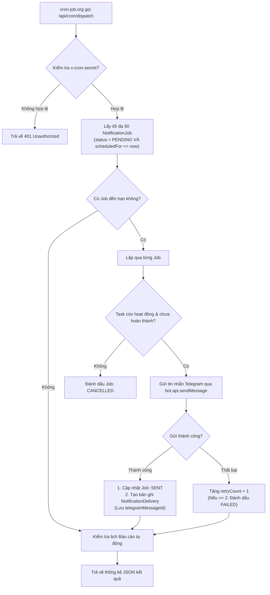
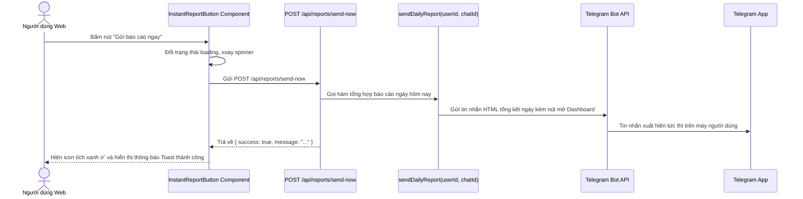

# ⏰ 04. HỆ THỐNG CRON & ĐIỀU PHỐI THÔNG BÁO

Tài liệu này giải thích chi tiết cơ chế hoạt động của vòng lặp gửi tin nhắn 24/7, cách thức hoạt động của cron-job.org, cơ chế báo cáo tự động và tính năng gửi báo cáo tức thì từ Web Dashboard triển khai tại [[src/lib/cron/dispatcher.ts](file:///home/zinex/code/Bot-notice/src/lib/cron/dispatcher.ts)].

---

## 1. TẠI SAO PHẢI DÙNG CRON-JOB.ORG VỚI VERCEL?

Mô hình Vercel Serverless không cho phép duy trì tiến trình chạy nền liên tục (như `setInterval` hay `node-cron`). Vercel Cron ở gói Free chỉ hỗ trợ tối đa 1 lần chạy mỗi ngày, không thể phục vụ việc nhắc nhở từng phút.

**Giải pháp**: Sử dụng dịch vụ miễn phí **[cron-job.org](https://cron-job.org)** để gửi HTTP POST request định kỳ về ứng dụng:
- **Tần suất**: Mỗi 1 phút một lần (`* * * * *`), hoạt động 24/7.
- **Bảo mật**: Header `x-cron-secret` ngăn chặn người lạ kích hoạt API.

---

## 2. LUỒNG ĐIỀU PHỐI THÔNG BÁO (`dispatchDueNotifications`)

Mỗi khi cron-job.org gọi đến `POST /api/cron/dispatch`:

### Tính Bất Biến & Chống Gửi Lặp (Idempotency):
- Khi một Job được xử lý thành công, nó được chuyển ngay sang trạng thái `SENT` trong một Prisma Transaction.
- Nếu cron-job.org vô tình gọi 2 lần trong cùng 1 phút, lần gọi thứ hai sẽ không tìm thấy Job nào ở trạng thái `PENDING`, đảm bảo **tuyệt đối không bao giờ gửi tin nhắn trùng lặp cho người dùng**.

---

## 3. CƠ CHẾ BÁO CÁO TỰ ĐỘNG (AUTOMATED REPORTS)

Cuối mỗi chu kỳ dispatch, hệ thống tự động kiểm tra xem đã đến giờ gửi các báo cáo định kỳ hay chưa qua hàm `checkAndSendAutomatedReports()`:

### 1. Báo cáo Ngày (Daily Summary):
- **Điều kiện kích hoạt**: `dailyEnabled = true`, giờ hiện tại $\ge$ `dailyTime` (mặc định `22:00` VN) và hôm nay chưa gửi (`lastDailySentAt !== todayStr`).
- **Nội dung**: Tỷ lệ hoàn thành công việc, số lượng việc đã làm / tổng số việc, tổng số ml nước đã uống, số phút tập thể dục, số phút học tập và chuỗi ngày duy trì (Streak).
- **Cập nhật mốc**: Ghi nhận `lastDailySentAt = now` để không gửi lặp lại trong ngày.

### 2. Báo cáo Tuần (Weekly Summary):
- **Điều kiện kích hoạt**: `weeklyEnabled = true`, hôm nay là ngày được chọn (`weeklyDay` - mặc định Chủ Nhật = 0) và giờ hiện tại $\ge$ `weeklyTime` (mặc định `21:45` VN).
- **Nội dung**: Tổng kết 7 ngày vừa qua, so sánh hiệu suất với tuần trước.

### 3. Báo cáo Tháng (Monthly Summary):
- **Điều kiện kích hoạt**: `monthlyEnabled = true`, hôm nay là ngày cuối cùng của tháng và giờ hiện tại $\ge$ `monthlyTime` (mặc định `22:15` VN).
- **Nội dung**: Bảng đánh giá tổng quan tháng, tỷ lệ cam kết thói quen.

---

## 4. TÍNH NĂNG "GỬI BÁO CÁO NGAY LẬP TỨC" TỪ WEB DASHBOARD

Ngoài việc gửi tự động theo giờ cấu hình, người dùng có thể chủ động bấm nút **"Gửi báo cáo ngay"** bất cứ lúc nào trên Web:

### Các vị trí tích hợp nút Gửi báo cáo tức thì:
1. **Thanh Topbar** ([[Topbar.tsx](file:///home/zinex/code/Bot-notice/src/components/Topbar.tsx)]): Thường trực ở mọi trang, 1 click là gửi.
2. **Banner Tổng quan** ([[overview/page.tsx](file:///home/zinex/code/Bot-notice/src/app/overview/page.tsx)]): Nút to nổi bật `[📊 Gửi báo cáo ngay qua Telegram]`.
3. **Trang Thống kê** ([[analytics/page.tsx](file:///home/zinex/code/Bot-notice/src/app/analytics/page.tsx)]): Đặt cạnh bộ chọn ngày.
4. **Trang Cài đặt** ([[settings/page.tsx](file:///home/zinex/code/Bot-notice/src/app/settings/page.tsx)]): Trong mục cấu hình báo cáo.
